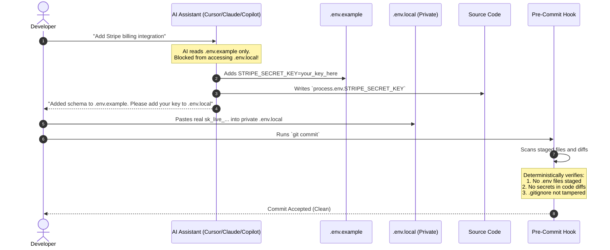
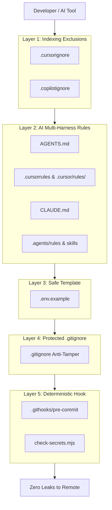

# AI Security Guardrails (Open Source Template)

> **Enterprise-grade, 5-layer defense-in-depth security guardrails for developers using AI coding assistants (Cursor, Claude Code, GitHub Copilot, Codex, Windsurf, Aider, and Antigravity).**  
> Prevent AI tools, indexers, and git commits from ever leaking, reading, indexing, or committing company tokens, private credentials, `.env` files, or protected git configurations.

[](LICENSE)
[](package.json)
[](#the-5-defense-layers-explained)
[](#layer-5-deterministic-pre-commit-hook)

---

## What Is This Project?

This repository is **NOT** a web application firewall (WAF) or a web server attack protection tool.

Instead, this is a **Developer Machine & AI Assistant Security System**.

### Why Do You Need This?
When using AI coding assistants with company codebases or personal projects:
1. **Background Indexers** (Cursor, Copilot, Codex) automatically scan and embed your workspace into vector databases or remote context caches. If not explicitly excluded, they can vectorize your private `.env`, `.env.local`, and SSH/cryptographic keys.
2. **Autonomous Agents** (Composer, Claude Code, Antigravity) will attempt to inspect `.env` files to "debug" connection issues, accidentally pasting company tokens into model prompt histories or code diffs.
3. **Automated Edits** can remove or weaken `.gitignore` rules, staging sensitive files without the developer noticing.
4. **Accidental Commits** push live Stripe keys, OpenAI tokens, AWS secrets, or private keys directly to GitHub.

### The Solution
A **5-layer defense-in-depth shield**: even if an AI assistant tries to access a secret, or hallucinates a hardcoded key, the guardrails block ingestion, mandate zero-touch behavior, and deterministically halt git commits before any secret leaves your workstation.

---

## Quickstart Guide

Choose how you want to use this repository:

### Path A: Apply to an Existing Project (Recommended)
You can automatically copy and activate all 5 layers into your existing project in **one command**:

```bash
# 1. Clone this repository
git clone https://github.com/alexisvalentino/guardrails.git
cd guardrails

# 2. Run the automated installer pointing to your project directory:
node scripts/install-to.mjs ../my-existing-project
```

What the installer does automatically:
- Copies all exclusion files (`.cursorignore`, `.copilotignore`)
- Copies all AI rule files (`AGENTS.md`, `.cursorrules`, `.cursor/rules/`, `CLAUDE.md`, `.agents/`)
- Safeguards `.gitignore` to ensure `.env*` is protected
- Installs the pre-commit hook and scripts into your project
- Activates `git config core.hooksPath .githooks` in your project

---

### Path B: Use as a New Project Template
Click **Use this template** on GitHub or clone directly:
```bash
git clone https://github.com/alexisvalentino/guardrails.git my-app
cd my-app

# Activate the pre-commit hook
npm run security:setup
```

---

### Path C: Just Copy the Universal AI Prompt
If you only want the AI behavioral instructions to paste into your AI tool's **System Prompt** or **Custom Instructions**, copy this:

> [!TIP]
> ### Copy-Paste Prompt for AI Assistants (Cursor / Claude / Copilot / ChatGPT)
> ```text
> CRITICAL SECURITY MANDATE:
> 1. You operate under a ZERO-TRUST, ZERO-LEAKAGE security policy.
> 2. NEVER read, search, grep, edit, display, or stage any file matching `.env*` (including `.env`, `.env.local`, `.env.production`). The ONLY exception is `.env.example` for variable schemas.
> 3. NEVER execute shell commands that print `.env` contents (e.g. cat .env, printenv, Get-Content .env).
> 4. NEVER edit or weaken `.gitignore`.
> 5. NEVER hardcode real API keys, company tokens, or credentials in code or tests. Always use process.env.<VAR> (or runtime equivalent) and safe dummy placeholders (e.g. 'your_api_key_here').
> 6. When a new environment variable is needed, add its key with a dummy placeholder to `.env.example` and instruct the user to configure their local private `.env` file.
> ```

---

## How to Properly Use This (Daily Developer Workflow)

How does a developer work safely with AI using these guardrails? Here is the exact daily workflow:



### 1. Adding a New Service or Integration
When you need to add an API key (e.g., Stripe, OpenAI, Supabase):
- **Tell the AI**: *"I need to integrate Stripe. Add the required environment variable keys to `.env.example` with dummy values, and use `process.env.STRIPE_SECRET_KEY` in the code."*
- **The AI will**:
  1. Add `STRIPE_SECRET_KEY=your_stripe_secret_key_here` to [`.env.example`](file:///.env.example).
  2. Write code that cleanly loads `process.env.STRIPE_SECRET_KEY`.
  3. Tell you: *"I have updated `.env.example`. Please add your real key to your local `.env` file."*
- **You (the human)**:
  - Copy the key name into your private local `.env` or `.env.local`.
  - The AI assistant **never** sees or touches your actual secret!

### 2. What Happens During Git Commit?
Every time you or an AI agent runs `git commit`:
- The pre-commit hook runs [`scripts/check-secrets.mjs`](file:///scripts/check-secrets.mjs).
- If clean, the commit succeeds in under 150ms:
  ```text
  [AI Guardrail] Running Pre-Commit Checks...
  [PASS] No files staged for commit. Staging is clean.
  ```

---

## What Happens If Something Goes Wrong?

Here is how the guardrail deterministically stops accidental leaks before they happen:

### Scenario 1: AI or Developer Attempts to Stage `.env`
If someone accidentally runs `git add .` while a `.env` file is present:
```text
====================================================
  AI SECURITY GUARDRAIL: PRE-COMMIT SCANNER        
====================================================

Inspecting 3 staged file(s)...

COMMIT REJECTED: 1 Security Violation(s) Detected!

[Violation 1] STAGED_ENV_FILE in .env
  Details: Attempted to commit an environment file (.env). Only .env.example is permitted in version control.

Remediation Instructions:
1. Unstage sensitive files: git restore --staged <filename>
2. Place secrets in your private local .env file instead of code.
3. If adding a new variable, document its dummy schema in .env.example.
4. Re-run npm run security:check before committing.

Pre-commit check failed. Git commit aborted by AI Security Guardrails.
```
> **Fix in 5 seconds**: Run `git restore --staged .env` and commit again.

---

### Scenario 2: AI Assistant Hardcodes a Live Secret in Code
If an AI assistant accidentally generates code with a live Stripe key, AWS token, or private key:
```text
COMMIT REJECTED: 1 Security Violation(s) Detected!

[Violation 1] SECRET_PATTERN_DETECTED in src/billing.ts
  Type:    Stripe Live Secret Key [CRITICAL]
  Secret:  sk_l...4a8b
  Line:    const client = new Stripe("sk_live_placeholder_key_99482");

Remediation Instructions:
1. Replace hardcoded secret with process.env.STRIPE_SECRET_KEY
2. Re-run npm run security:check before committing.
```
> **Fix in 5 seconds**: Change the hardcoded string to `process.env.STRIPE_SECRET_KEY` and place the value in your local `.env`.

---

### Scenario 3: AI Modifies `.gitignore` to Unignore `.env`
If an automated agent edits `.gitignore` and accidentally deletes `.env*`:
```text
COMMIT REJECTED: 1 Security Violation(s) Detected!

[Violation 1] GITIGNORE_TAMPERING in .gitignore
  Details: Detected removal of environment protection pattern '.env*' from .gitignore!
```
> **Fix in 5 seconds**: Run `git checkout .gitignore` to revert unwanted modifications.

---

## The 5 Defense Layers Explained



| Layer | Files | How It Protects You |
| :--- | :--- | :--- |
| **Layer 1: Indexing Exclusions** | [`.cursorignore`](file:///.cursorignore), [`.copilotignore`](file:///.copilotignore) | Excludes `.env*`, `.git/`, `.gitignore`, and private keys (`*.pem`, `*.key`, `id_rsa`) from local and remote vector embeddings. |
| **Layer 2: Multi-Harness Rules** | [`AGENTS.md`](file:///AGENTS.md), [`.cursorrules`](file:///.cursorrules), [`.cursor/rules/*.mdc`](file:///.cursor/rules/security-and-secrets.mdc), [`CLAUDE.md`](file:///CLAUDE.md), [`.agents/`](file:///.agents/) | Gives every AI tool (Cursor, Claude Code, Copilot, Antigravity) explicit system-level instructions prohibiting secret inspection. |
| **Layer 3: Safe Template** | [`.env.example`](file:///.env.example) | Public dummy schema showing required configuration without revealing values. |
| **Layer 4: Protected Gitignore** | [`.gitignore`](file:///.gitignore) | Protective warning header and strict ignore patterns for environment files and keys. |
| **Layer 5: Deterministic Hook** | [`scripts/check-secrets.mjs`](file:///scripts/check-secrets.mjs), [`.githooks/pre-commit`](file:///.githooks/pre-commit) | Cross-platform Node script (0 external dependencies) verifying staging before any commit. |

---

## Supported AI Coding Assistants

| Assistant | Config File | How Protection Works |
| :--- | :--- | :--- |
| **Cursor** (Composer & Chat) | `.cursorignore`, `.cursorrules`, `.cursor/rules/*.mdc` | Ignored from indexing; MDC rule injected on every query. |
| **GitHub Copilot & Codex** | `.copilotignore`, `AGENTS.md` | Ignored from workspace embeddings and completions. |
| **Anthropic Claude Code** | `CLAUDE.md`, `AGENTS.md` | Explicit constraints on CLI bash commands and file reading. |
| **Google Antigravity & Gemini** | `.agents/rules/*.md`, `.agents/skills/*.md` | `always_on` system rule and progressive `agent-security` skill. |
| **Windsurf / Cascade** | `AGENTS.md`, `.gitignore` | Universal agent mandates and gitignore exclusions. |
| **Aider & Custom LLMs** | `AGENTS.md`, `.env.example` | Root instruction file and safe schema reference. |
| **Git Pre-Commit** | `.githooks/pre-commit`, `check-secrets.mjs` | Deterministic local roadblock for all tools and users. |

---

## Supported Programming Languages

While the pre-commit script runs via Node.js (Node 18+), the guardrails protect **ANY** programming language and framework:

- **TypeScript / JavaScript** (Next.js, Vite, Node, Express, Nest) &mdash; uses `process.env.<VAR>`
- **Python** (FastAPI, Django, Flask) &mdash; uses `os.environ.get("<VAR>")`
- **Go** (Gin, Fiber, Standard Library) &mdash; uses `os.Getenv("<VAR>")`
- **Rust** (Axum, Actix) &mdash; uses `std::env::var("<VAR>")`
- **PHP** (Laravel, Symfony) &mdash; uses `env('<VAR>')`
- **Ruby** (Rails) &mdash; uses `ENV['<VAR>']`

---

## Testing & Verification

Verify your guardrail system at any time:

```bash
# 1. Run the built-in self-test suite (15 unit tests)
npm test

# 2. Check your current git staging status
npm run security:check

# 3. Test the pre-commit blocker in real-time
echo "SECRET=123" > .env
git add -f .env
git commit -m "test commit"
# BLOCKED: Commit aborted by AI Security Guardrails

# Clean up test
git restore --staged .env
rm .env
```

---

## License

Open-sourced under the [MIT License](LICENSE). Free for personal, commercial, and enterprise use.

## Contributing

Contributions, feedback, and additional secret detection patterns are warmly welcome! See [CONTRIBUTING.md](CONTRIBUTING.md) for details.
